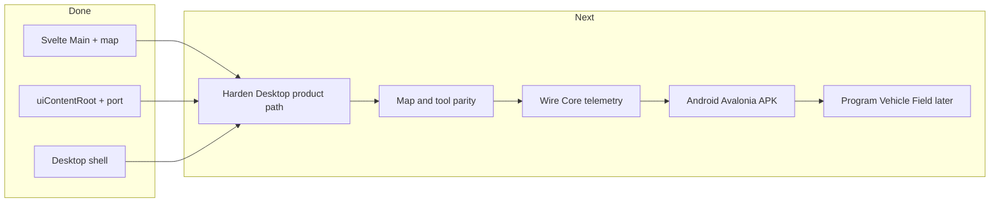

# SeederTerminal next steps (post-spike)

## Where we are

Spike succeeded:

- Svelte Main on Vite `:5175` with CanvasKit map, pose interpolation, ground texture, grid, overlays, EN/UK
- AgOpenWeb `RemoteServerHost` / `WebBackend` accept `port` + `uiContentRoot`
- [`SeederTerminal.Desktop`](../SeederTerminal.Desktop/) hosts WebBackend on **5175** + WebView; Core `ISeederTelemetrySource` exists but UI still simulates client-side
- Android is contract-only ([`README.md`](../SeederTerminal.Android/README.md))

Day-to-day spike still often uses **AgOpenWeb Desktop `:5174` + Vite proxy**. Product path is **one process**: Seeder Desktop serves `dist/` + `/ws` + vendor assets.



## Priority (locked)

**Balanced:** ship a reliable Desktop product loop first, then map/tool parity, then telemetry wiring, then Android, then extra pages. Themes and cloud stay deferred.

---

### Phase A — Desktop product path (must work without AgOpenWeb Desktop)

Goal: `npm run build` + `dotnet run` Seeder Desktop is the normal cabin loop.

- Verify `BuildSeederWeb` always produces `wwwroot/` next to the exe; fail the build loudly if `dist`/`index.html` missing
- Confirm single-host serves: SPA, `/ws`, CanvasKit `/vendor`, `/icons`, `/sattile`, `/backpic` (no Vite proxy)
- Harden splash / start-failure UX in `MainWindow.cs`
- Document in `SeederTerminal.Web/README.md`: **dev** = AgOpenWeb `:5174` + `npm run dev`; **product** = Seeder Desktop only
- Keep AgOpenWeb `wwwroot` on `:5174` as reference only

### Phase B — Map / guidance visual parity

Stay in `renderer.ts` + related stores; do not fork WireCodec.

- Config-driven tool/vehicle size (replace hard-coded `toolW = 6`) from Scene/Status/config already on the wire
- Guidance line styling closer to AgOpenWeb (green line visibility, width in world metres)
- Section/tool colors: red when working, matching AgOpenWeb section codes
- Coverage / contour trail if Scene already projects it and it is cabin-useful
- Optional: light perspective / pitch later — only after top-down parity feels solid
- Keep pose buffer (~130 ms) as the motion model; tune only if Tick rate changes

### Phase C — Seeder telemetry path

Today: widgets use `seederSim.ts`. Core has `ISeederTelemetrySource` registered in Desktop but unused by the SPA.

- Drive sim from **Core** (or project samples onto Status/Tick / a small Seeder-owned WS extension) so Desktop and future Android share one source
- SPA widgets subscribe to that feed; keep client sim only as a Vite-dev fallback when no host telemetry is present
- Leave `Ros2SeederTelemetrySource` as stub until a real ROS2 bridge exists

### Phase D — Android product head

Mirror `Platforms/AgOpenWeb.Android`: foreground `BackendService` + `NativeWebView` → `http://127.0.0.1:5175/`, unpack/serve Vite `dist` as `uiContentRoot`. Until then, LAN browser against Desktop remains the cabin Android workaround.

### Phase E — Product UX beyond Main (after A–C)

- Drawer stubs → Program / Vehicle / Field pages only when a cabin workflow needs them
- Widget polish (layout, hit targets, night readability) without a full theme system yet
- i18n coverage for new strings (EN + UK)

### Explicitly later

- Themes / multi-skin
- Cloud sync
- Replacing AgOpenWeb reference PWA
- Deep map port of entire monolithic `app.js` (prefer incremental parity)

## Definition of done for “next milestone”

1. Operator can run **only** Seeder Desktop and get map + overlays + section commands on `:5175`
2. Tool/vehicle draw sizes and guidance/section colors match AgOpenWeb closely enough for cabin use
3. Singulation / seed rate come from Core sim (or wire), not a disconnected browser-only timer in product mode
4. Phases below checked off as complete; `SPIKE_NOTES.md` left as spike history

## Phase checklist

- [ ] Phase A — Desktop product path
- [ ] Phase B — Map / guidance visual parity
- [ ] Phase C — Seeder telemetry path
- [ ] Phase D — Android product head
- [ ] Phase E — Product UX beyond Main

## Run modes

**Dev (hot reload):**

```bash
dotnet run --project Platforms/AgOpenWeb.Desktop/AgOpenWeb.Desktop.csproj
cd SeederTerminal/SeederTerminal.Web && npm run dev
# http://localhost:5175 (proxies /ws + vendor to :5174)
```

**Product (single process):**

```bash
cd SeederTerminal/SeederTerminal.Web && npm run build
dotnet run --project SeederTerminal/SeederTerminal.Desktop/SeederTerminal.Desktop.csproj
# WebView → http://127.0.0.1:5175/
```
