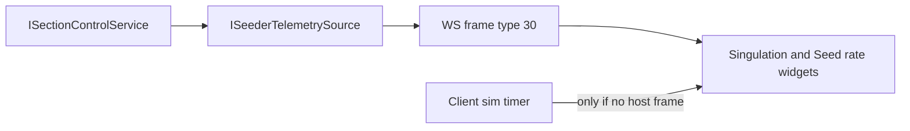

---
name: Phase D telemetry
overview: Drive singulation and seed rate from the Desktop Core telemetry source over a Seeder-owned WebSocket frame, and show one seed-rate row per section so both widgets always list the same sections.
todos:
  - id: wire-hook
    content: Reserve WS type 30 and ExtraFrameProvider on RemoteServerHost / MapBroadcaster (2 Hz + connect seed)
    status: pending
  - id: core-source
    content: Per-section seed rate on the sim source, frame encoder, and SeederTelemetryWiring.Attach from Desktop
    status: pending
  - id: spa-widgets
    content: Decode the frame, host-vs-dev-sim fallback, and per-section seed-rate rows matching singulation
    status: pending
  - id: tests-docs-verify
    content: Core unit tests, NEXT_STEPS checklist, and browser check of product and Vite-dev paths
    status: pending
isProject: false
---

# Phase D — Seeder telemetry path

The Phase D heading in [SeederTerminal/Plans/NEXT_STEPS.md](SeederTerminal/Plans/NEXT_STEPS.md) is the telemetry path (the checklist lines below it swap D and E). This work is that telemetry path. Android stays the later phase.

Today the SPA timer in [seederSim.ts](SeederTerminal/SeederTerminal.Web/src/lib/stores/seederSim.ts) invents singulation and one aggregate seed rate. [SimulatedSeederTelemetrySource](SeederTerminal/SeederTerminal.Core/SimulatedSeederTelemetrySource.cs) is registered in [MainWindow.cs](SeederTerminal/SeederTerminal.Desktop/MainWindow.cs) and never ticked. Singulation already lists one row per section; seed rate is a single bar.

## Wire hook (shared, Tick unchanged)

Leave `TickDto` and `StatusDto` positional layouts alone so the reference PWA on `:5174` keeps decoding.

- Reserve `WireCodec.SeederTelemetry = 30` in [WireCodec.cs](Shared/AgOpenWeb.RemoteServer/WireCodec.cs). AgOpenWeb hosts never send it. Both transport decoders already ignore an unknown type.
- Add `Func<byte[]?>? ExtraFrameProvider` on [RemoteServerHost](Shared/AgOpenWeb.RemoteServer/RemoteServerHost.cs) and [MapBroadcaster](Shared/AgOpenWeb.RemoteServer/MapBroadcaster.cs), same set-before-or-after-start pattern as `WizardProvider`.
- Call it under a lock from the existing ~2 Hz status slot in `RunAsync`, and append a non-null frame in `BuildSeed` so a new client gets values immediately.

Frame (little-endian): `u8 type=22`, `f64 setpoint`, `f64 actual`, `f64 totalSingulation`, `i32 count`, then per section `u8 isOn`, `f32 singulationPercent`, `f32 seedRateActual`. Index is implicit (1-based in the UI).

## Core source

Extend [SeederSectionSample](SeederTerminal/SeederTerminal.Core/ISeederTelemetrySource.cs) with `SeedRateActual`. Setpoint stays one implement-wide number (`182_000`).

[SimulatedSeederTelemetrySource.Tick](SeederTerminal/SeederTerminal.Core/SimulatedSeederTelemetrySource.cs) keeps one sample per color code from `ISectionControlService` (`NumSections`, clamped like [SceneProjector.BuildTick](Shared/AgOpenWeb.RemoteServer/SceneProjector.cs)):

- Planting (color codes 1, 2, 3): singulation around 97%, section rate around the setpoint.
- Not planting (0 off, 4 turning on, 5 auto off): both values 0.
- Header singulation and header actual are the mean of planting sections (0 when none are planting), so the header matches the rows.

`Ros2SeederTelemetrySource` stays a zero stub.

New `SeederTelemetryWiring.Attach(server, source, sections)` in Core (Core already references RemoteWiring):

- Read section color codes, call `Tick`, encode the frame.
- Lock around `Tick` plus encode so the connect seed and the 2 Hz loop cannot interleave.
- A count of 0 (tool not configured yet) encodes as empty and does not count as live data.

Call `Attach` from Desktop `StartBackendAsync` after `WebBackend.StartAsync`, using the existing `ISeederTelemetrySource` and `ISectionControlService`. Android is not wired in this phase; the same `Attach` is what that head will call later.

## SPA

- Decode type 30 in [transport.js](SeederTerminal/SeederTerminal.Web/src/lib/remote/transport.js) and add `onSeederTelemetry` in [session.ts](SeederTerminal/SeederTerminal.Web/src/lib/remote/session.ts).
- [seederSim.ts](SeederTerminal/SeederTerminal.Web/src/lib/stores/seederSim.ts) stores one section list used by both widgets (`index`, `isOn`, `singulationPercent`, `seedRateActual`) plus setpoint, actual, and total singulation.
- Product mode: the first host frame with `count > 0` stops the browser timer and owns the stores.
- Dev mode (`npm run dev` proxied to AgOpenWeb `:5174`, which never sends type 30): start the existing ~900 ms client sim after a short wait (~1.5 s) so the Seeder Desktop WebView does not flash fake numbers. Client sim uses the same planting-code rule and the same per-section rate fields, with section count from `tick.sections` (fallback 6 only before the first tick).
- Disconnect keeps the last host values. Sim resumes only when a host frame has never arrived.

[SeedRateWidget.svelte](SeederTerminal/SeederTerminal.Web/src/lib/components/SeedRateWidget.svelte) keeps the actual / setpoint / deviation header and adds one row per section, same indices and on/off coloring as [SingulationWidget.svelte](SeederTerminal/SeederTerminal.Web/src/lib/components/SingulationWidget.svelte). Row bar width is `sectionRate / setpoint` (capped like today’s single bar). Same `max-height` and scroll as singulation. Both landscape and portrait copies in [App.svelte](SeederTerminal/SeederTerminal.Web/src/App.svelte) are that one component. No new i18n strings.

## Close-out

- Unit tests for `Tick`: N codes produce N samples; codes 0/4/5 are zeros; codes 1/2/3 are non-zero; header actual is the mean of planting rows. Plus an encode/decode round-trip of the frame. There is no Core test project today; add `Tests/SeederTerminal.Core.Tests` and include it in the solution test run.
- Check off telemetry in [NEXT_STEPS.md](SeederTerminal/Plans/NEXT_STEPS.md) and align the checklist labels with the headings (D telemetry, E Android). Update the “UI still simulates client-side” line.
- Verify in the browser: with Seeder Desktop (`:5175`), both widgets list the same section count as the tool, rows go to zero when a section is off, and the header tracks the planting rows. With Vite against `:5174`, the client sim still fills both widgets with that same count.
